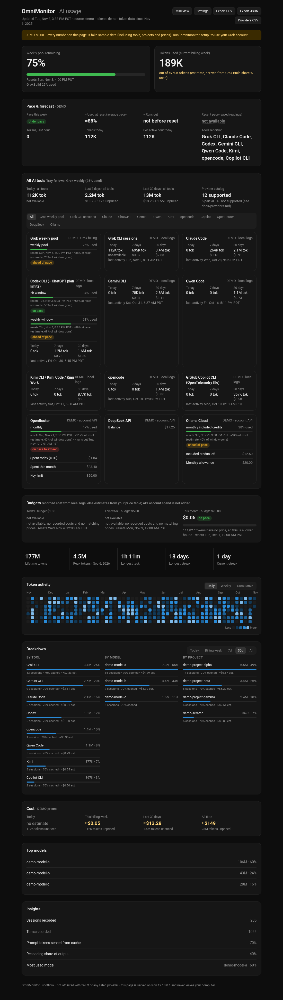
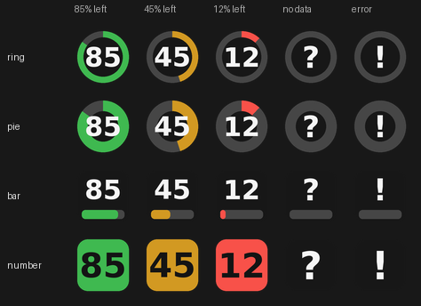
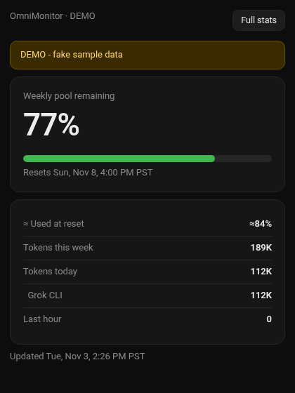
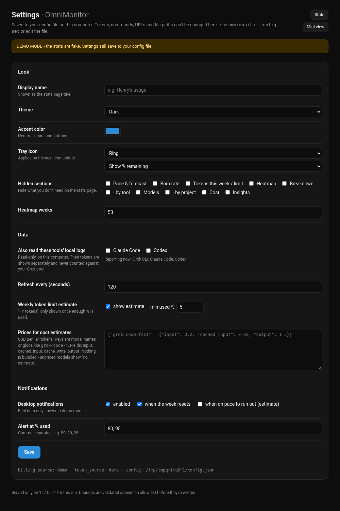
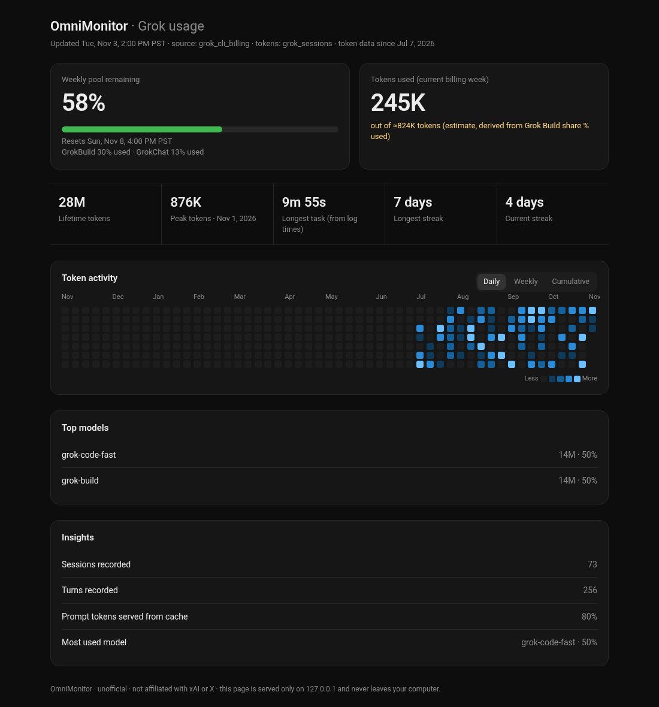

# OmniMonitor

**Local-first tray app that monitors AI usage, limits and spend across Grok, Claude,
ChatGPT/Codex, Gemini, DeepSeek, Qwen, Kimi, Cursor, Copilot and more. No cookies, no
scraping.**

OmniMonitor reads two kinds of sources, both **opt-in**:

* **Local logs** written by the AI tools on your own computer (read-only): Grok CLI,
  Claude Code, Codex, Gemini CLI, Qwen Code, Kimi CLI / Kimi Code / Kimi Work, opencode and
  the GitHub Copilot CLI.
* **Official account APIs** with your own key: Anthropic Admin, OpenAI, xAI, DeepSeek,
  Moonshot (Kimi), GitHub Copilot, Cursor teams, OpenRouter and Ollama Cloud, plus the Grok
  weekly usage pool.

It shows remaining limits, tokens by tool / model / project, estimated cost from **your own**
price table, weekly pace, threshold alerts and CSV/JSON export on a private page served only
to your own computer. It never reads browser cookies or keychains, and shows "not available"
instead of guessing. The full matrix, including what is **not** supported and why, is in
[docs/providers.md](docs/providers.md).

Runs on **macOS** (Apple Silicon and Intel), **Windows 10/11** and **Linux** (GNOME/KDE). It
is the standalone successor to the old SwiftBar plugin in [`legacy/`](legacy/), so SwiftBar
is no longer needed.

> **Unofficial. Not affiliated with, endorsed by, or supported by xAI, X, Anthropic, OpenAI,
> Google or any other listed provider.** Product names are trademarks of their owners and are
> mentioned only to describe what the app works with. The Grok weekly pool comes from an
> **undocumented** endpoint used by the official Grok CLI, so it may break at any time. See the [disclaimer](#disclaimer).
>
> *OmniMonitor was previously called `grok-usage-tray`.* Existing configs and autostart
> entries are migrated automatically; see [Upgrading from grok-usage-tray](#upgrading-from-grok-usage-tray).



<sub>Screenshot rendered from **demo mode** (fake, labeled data). Tray icons: green ≥ 50 %
left, yellow ≥ 20 %, red below that, gray `?` = no data yet, gray `!` = error, blue dot =
demo.</sub>



<sub>Icon styles (`icon_style`): ring, pie, bar, number. Colors follow what's left.</sub>

| Mini view | Settings page |
|---|---|
|  |  |

### Inspired by Token Monitor

The 0.2.0 features were inspired by **[Token Monitor](https://github.com/Javis603/token-monitor)**
by Javis (MIT License, © 2026 Javis), an Electron desktop widget for token usage across many
AI tools. OmniMonitor copies **no code, text, icons or images** from it. Everything is our own
Python re-implementation of the ideas. See [docs/inspiration-notes.md](docs/inspiration-notes.md)
for what we adopted, what we built differently and why.

## What's new in 0.4.2

Native window UX: redesigned tray icon (crisp macOS template ring / Windows-Linux gauge), real mini window that doesn't leave you in the browser, Full stats opens the native window, exports and external links work inside the app window, clearer empty-token reasons, and a Report a problem button. See [release notes](docs/release-notes/v0.4.2.md).

### Earlier: 0.4.1

- **Fix: stuck on demo numbers after the in-app Setup.** The Setup page now shows your Grok login state and the exact `grok login` command, and a **Use my real Grok usage** button switches off demo mode (only after a successful usage read).
- The running app reloads `config.json` when it changes, logs every poll, and `omnimonitor doctor` shows what the running app is using.
- Clearer message when Grok token stats are not available yet.

## What's new in 0.4.0

- **Native app window** (pywebview) with an app-style UI: sidebar, dashboard charts, providers, stats and settings.
- **Setup wizard** (`omnimonitor setup` and in the app) that detects provider CLIs and can install them with each vendor's official installer.
- **More providers.** The matrix now has 56 entries: 13 supported, 11 partial, 11 experimental and 21 not supported, each with a reason ([docs/providers.md](docs/providers.md)).
  - New local logs: Claude Code transcripts with ≈5-hour block estimates, Kimi Work shareDir, Pi, Goose and Hermes (partial), and Grok CLI unified log, Antigravity, DeepSeek Harness, OpenClaw, Amp, Factory Droid, Cline, Roo Code and Kilo Code (experimental).
  - New API readers (your own key, env var or `secrets.json` only): Vercel AI Gateway (supported), DeepInfra, Fireworks and xAI month-to-date spend plus spending limit (partial), and Venice and self-hosted LiteLLM (experimental).
  - Documented as not supported, with the reason: z.ai, Volcengine, Hugging Face and Amazon Bedrock.
- **Service status badges** (opt-in, off by default) from official status pages: Claude, OpenAI, GitHub, Cursor, Fireworks and Vercel.
- **Reset countdowns** next to every reset time.
- **Proxy support** (`proxy_url`, CLI or config only).
- **`omnimonitor statusline [--json]`**: an offline one-line summary for shell prompts and tmux.
- Packaging: macOS `.dmg` files (ad-hoc signed app with an Applications link) and a Linux AppImage, in addition to the zip and tar.gz.

See [CHANGELOG.md](CHANGELOG.md) for details and for what isn't verified yet.

## What's new in 0.3.1

Fixes for the prebuilt apps: the macOS menu-bar app no longer crashes on launch ("trace trap"),
HTTPS uses the bundled certifi CA list (no more `CERTIFICATE_VERIFY_FAILED`), and there is a
log file (`~/Library/Logs/OmniMonitor/omnimonitor.log` on macOS). See CHANGELOG.md.

## What's new in 0.3.0

- **33-entry provider matrix** ([docs/providers.md](docs/providers.md), generated from the
  code): 12 supported, 6 partial and 15 not supported, each with source, auth, what's shown,
  reset period, confidence and doc links. Unsupported entries say why and what would be
  needed. `omnimonitor providers` prints the same table.
- **New local-log adapters (read-only, incremental):** Gemini CLI, Qwen Code, Kimi CLI /
  Kimi Code / Kimi Work, opencode (JSON files or `opencode.db` opened read-only) and
  GitHub Copilot CLI (OpenTelemetry file export). **Codex plan limits:** the 5-hour and
  weekly % that Codex itself writes to its logs.
- **New account adapters (official APIs, your own key):** Anthropic Admin cost report,
  OpenAI organization costs, xAI prepaid balance, DeepSeek balance, Moonshot (Kimi API)
  balance, GitHub Copilot premium requests, Cursor team spend, OpenRouter key credits and
  limits, Ollama Cloud balance. Called at most every 5 minutes (default 15), HTTPS only, to an
  allow-list of hosts, no redirects. The last good reading is kept when a call fails.
- **Per-provider switches and a primary picker:** `omnimonitor providers enable|disable|primary`
  or the Providers table in Settings. The tray shows the primary provider's % (Grok, Codex,
  Copilot, Cursor team, OpenRouter, Ollama Cloud or your tightest budget). When the primary
  has no reading, the tray falls back to the Grok pool and says so.
- **Unified provider cards** on the stats page: one card per enabled provider with tokens
  and cost today / 7 days / 30 days, limit %, pace, reset time, balances and errors, plus
  **all-tools totals**.
- **USD budgets:** daily, weekly and monthly caps on the ≈ cost of local tool usage, with
  alerts at `budget_alert_percent` and at 100 %.
- **Per-provider alert thresholds** (`provider_thresholds`), e.g. `{"codex": [75, 90]}`.
- **Compact tray tooltip** ("OmniMonitor - Grok weekly pool 38% used · today 1.2M tok · $3.40") and one menu line per
  enabled provider.
- **API keys** only from environment variables or a chmod-600 secrets file
  (`omnimonitor secrets set NAME`, input hidden). They are never accepted from or shown in the
  web UI, which shows only whether a key is set and where it came from (env / file).
- **Config export / import** (`omnimonitor config export [FILE]`, `config import FILE`):
  validated settings only, never tokens, keys or environment overrides.
- **`omnimonitor doctor`** now checks every enabled provider: log folders found for local
  adapters; key present, secrets file private and one live read for account adapters
  (skip the live read with `--offline`).
- **Exports** include provider readings (`export --kind providers`, CSV or JSON).

## What's new in 0.2.0

- **More tools (opt-in):** Claude Code and Codex token counts from their local logs, shown
  per tool. They **never** count toward the Grok pool. See
  [docs/token-adapters.md](docs/token-adapters.md).
- **Breakdowns** by tool, model and project for today, the billing week, 7 days, 30 days
  and all time, with the cache-hit share per row.
- **Cost:** costs recorded in the Grok logs, plus **≈ estimates** from a `prices` table
  *you* fill in. No prices are bundled. Unpriced tokens are counted and shown as "no
  estimate", never guessed.
- **Pace and forecast:** "≈ used at reset" and "≈ runs out" from the real weekly % and
  period dates (average pace) plus your own saved readings (recent pace). Shows "not
  available" when there's too little data.
- **Burn rate:** tokens in the last hour and per active hour today.
- **Desktop alerts** at % used thresholds (default 80 / 95), when the week resets, and
  optionally when you're on pace to run out. Each fires once per billing period and never on
  demo data.
- **Export:** `daily.csv`, `daily-models.csv`, `breakdown.csv` and `export.json` from the
  tray menu, the stats page or `omnimonitor export`. Spreadsheet formula injection is
  neutralized.
- **Personalization:** dark / light / auto theme, accent color, display name, hidden cards,
  heatmap length, tray icon style and remaining-vs-used number.
- **Settings page** (`…/settings`) and **mini view** (`…/mini`), both local only.
- **New commands:** `breakdown`, `providers`, `export`, `config get/set/keys`, `notify-test`.

---

## What it shows

**Tray menu**

- `72% left`: remaining share of the weekly pool. In demo mode this reads `DEMO · 72% left`.
- `Resets Sun Nov 8, 4:00 PM (in 4d 3h)`, in your local time.
- `Tokens: 1.9M of ≈8.7M (estimate)`, `Tokens this week: 1.9M (limit not exposed)` or
  `Tokens this week: not available`.
- `Today: 112K tokens (Grok CLI 80K, Claude Code 32K)` and `Pace: ≈84% used at reset
  (estimate)`, or `not available`.
- `⚠ <error>`, shown only when the last refresh failed. The last good value stays in the
  menu and is marked *stale*.
- **Refresh Now**, **Open Stats Page** (also the default action when you click the icon),
  **Open Mini View**, **Settings…**, **Export** (daily CSV, per-model CSV, tool/model/project
  CSV, everything as JSON), **Open Grok Usage Page**, **Edit Config**, **Quit**.

**Stats page** (`http://127.0.0.1:<random port>/s/<random secret>/`, opened from the menu)

| Stat | Where it comes from | Real or not |
|---|---|---|
| Weekly pool remaining %, reset time, per-product % | the billing endpoint | **real** (unofficial API) |
| Tokens used this billing week | Grok CLI session logs on **this computer** | **real**, but local CLI only |
| Weekly token limit ("out of Y") | **not exposed by xAI anywhere** | shown as *not available*, or as a flagged **≈ estimate** (see below) |
| Lifetime tokens, peak day, streaks, heatmap (Daily / Weekly / Cumulative) | session logs + local history | real, local CLI only |
| Longest task | turn durations in the logs, or the time between the first and last event of a turn | real; derived values are labeled "from log times" |
| Top models, insights (sessions, turns, cache share, reasoning share, recorded cost) | session logs | shown only if the data exists |
| Breakdown by tool / model / project | Grok CLI logs, plus Claude Code / Codex logs if enabled | real, local only; projects are folder names |
| Cost | `cost_usd` recorded in Grok logs, or your `prices` table | recorded = real; estimates are marked **≈** and list unpriced tokens |
| Pace & forecast | weekly % + period start/end + saved snapshots | **projection**, marked ≈; "not available" with too little data |
| Burn rate | event timestamps | real, local only |
| Top plugins | no source exposes this | card hidden |

Anything that cannot be measured says **"not available"**, with a tooltip that explains
why. Nothing is made up or silently estimated.

### Token stats: what's real, what isn't

- **The billing endpoint returns percentages, not tokens.** Your plan's weekly allowance is
  a pool of *credits* weighted by model, caching and product (Grok chat, Grok Build/CLI and
  others). Credits are not the same thing as tokens, and xAI does not publish a token limit.
- **Token counts come from the Grok CLI's own logs** (`~/.grok/sessions/**/updates.jsonl`,
  `turn_completed` events), read **read-only**. Usage on grok.com, in the mobile apps, in
  other tools or on other computers is **not** in those logs.
- **The "≈Y" estimate** is `tokens this week ÷ (Grok Build % used ÷ 100)`, or the overall %
  when no per-product number is returned. It appears only if `estimate_weekly_limit` is
  true **and** at least `estimate_min_used_percent` (default 5 %) is used. It is always
  shown with `≈` and the word *estimate*, and it can be far off. Set
  `"estimate_weekly_limit": false` to hide it.
- **History:** tokens, turns and billing snapshots are stored in a local SQLite file next
  to the config (`history.sqlite3`, chmod 600). On first run the app **backfills from any
  Grok CLI session logs already on disk**. Without such logs, history **starts from the day
  you install it**. The weekly % has no history API, so the snapshot history starts at
  install.

---

## Install

You need **Python 3.9+**. Prebuilt binaries are on
[GitHub Releases](https://github.com/whyarealltheuserstaken/OmniMonitor/releases/latest)
(macOS `.dmg`/`.zip`, Linux AppImage/`.tar.gz`, Windows `.zip`). Or install from source:

```bash
git clone https://github.com/whyarealltheuserstaken/OmniMonitor.git
cd OmniMonitor
python3 -m pip install --user .        # or: pipx install .
omnimonitor --demo                     # try it with fake data
```

### macOS (Apple Silicon and Intel)

**Prebuilt app (no Python needed):** download from
[Releases](https://github.com/whyarealltheuserstaken/OmniMonitor/releases/latest):
`omnimonitor-macos-arm64.dmg` for Apple Silicon (M1–M4), `omnimonitor-macos-x86_64.dmg` for
Intel (the same app as a `.zip` is attached too). Open the `.dmg` and drag `omnimonitor.app` onto
the Applications link (or unzip the `.zip` and move the app to `/Applications`). The app is **not signed or
notarized**, so macOS blocks the first launch. Either:

* **Finder:** right-click (Control-click) `omnimonitor.app` → **Open** → **Open**. On macOS 15
  Sequoia and later, if there is no Open button: try to open it once, then go to **System
  Settings → Privacy & Security**, click **Open Anyway** next to "omnimonitor" and confirm.
* **Terminal:** `xattr -dr com.apple.quarantine /Applications/omnimonitor.app`, then open it
  normally.

Only do this for a download you got from this repository's Releases page; you can check it
against `SHA256SUMS.txt` (`shasum -a 256 omnimonitor-macos-arm64.zip`). The command-line
interface is inside the bundle:
`/Applications/omnimonitor.app/Contents/MacOS/omnimonitor setup` (or `… doctor`).

If no menu-bar icon appears: on MacBooks with a notch it can be hidden behind the notch (quit
a few menu-bar apps or hold ⌘ and drag icons). The first launch shows a notification and opens
the stats page. Logs: `~/Library/Logs/OmniMonitor/omnimonitor.log` (hard crashes: `crash.log`).

**From source:**

```bash
brew install python                    # if you don't have Python 3.9+
pipx install /path/to/OmniMonitor      # or: python3 -m pip install --user .
omnimonitor setup
omnimonitor                            # the icon appears in the menu bar
```

The app runs as a normal background process, without a Dock icon. If macOS hides menu-bar
items (notch or full bar), use Bartender/Ice or Control Center settings to show it.

### Windows 10/11

**Prebuilt:** download `omnimonitor-windows-x86_64.zip`, unzip it and run `omnimonitor.exe`. It is
unsigned, so SmartScreen may warn: **More info → Run anyway**.

**From source:**

```powershell
py -m pip install --user .
omnimonitor setup
omnimonitor-gui            # same app, no console window
```

On Windows 11 the icon can land in the "hidden icons" overflow (^). Drag it onto the
taskbar to pin it.

### Linux

**Prebuilt (x86_64):** `chmod +x omnimonitor-linux-x86_64.AppImage && ./omnimonitor-linux-x86_64.AppImage`
(needs FUSE 2; without it run with `--appimage-extract-and-run`). Or unpack
`omnimonitor-linux-x86_64.tar.gz` and run `./omnimonitor`.

**From source:**

```bash
python3 -m pip install --user .     # Debian/Ubuntu may need: pipx install .
omnimonitor setup
omnimonitor
```

**Tray caveat (AppIndicator):** pystray needs a status-notifier/AppIndicator host.

- **GNOME** has none by default. Install the *AppIndicator and KStatusNotifierItem
  Support* extension (`gnome-shell-extension-appindicator`; Ubuntu ships it enabled).
- For the best backend also install the GObject bindings and indicator library:
  `sudo apt install python3-gi gir1.2-ayatanaappindicator3-0.1` (Fedora:
  `python3-gobject libayatana-appindicator-gtk3`). If you use a venv, create it with
  `--system-site-packages` so it can see `gi`.
- **KDE Plasma**, XFCE, Cinnamon and MATE show tray icons natively.
- Without a tray host the icon can't show. Use `omnimonitor serve --open` (stats page
  only) or `omnimonitor status` instead.

---

## Run

```bash
omnimonitor                     # tray app (same as `omnimonitor run`)
omnimonitor --demo              # force demo mode
omnimonitor status [--json]     # print once and exit (also handy for scripts)
omnimonitor serve --open        # stats page only, no tray
omnimonitor doctor              # diagnose CLI / login / billing / logs  (--offline, --json)
omnimonitor setup               # first run: check login, switch off demo mode  (-y = no prompt)
omnimonitor config-path         # where the config lives
omnimonitor breakdown --range 30d [--json]    # tokens by tool, model, project
omnimonitor blocks [--source all] [--json]    # ≈ 5-hour blocks + burn rate (estimate)
omnimonitor providers [--json]  # which local token logs exist / are enabled
omnimonitor export --format csv --kind daily -o daily.csv   # kinds: daily, daily-models, breakdown, events
omnimonitor export --format json -o export.json
omnimonitor config keys         # settings you can change safely
omnimonitor config set theme light            # validated, same rules as the settings page
omnimonitor config get notify_thresholds
omnimonitor notify-test         # check desktop notifications work
```

The stats page links to the **mini view** (a compact page for a small browser window) and the
**settings page**. Both URLs carry the same per-run secret as the stats page.

### First run

1. Install the official Grok CLI and sign in once (`grok login`). See https://docs.x.ai.
2. Run `omnimonitor setup`. It checks the CLI, your login, a billing call and your
   session logs, and switches `source` to `grok_cli_billing` **only if the billing call
   worked**.
3. Run `omnimonitor`. Until setup succeeds, the app stays in **demo mode**: every
   number is fake and labeled **DEMO**.

### Start at login

```bash
omnimonitor install-autostart         # and: omnimonitor uninstall-autostart
```

| OS | What it creates |
|---|---|
| macOS | `~/Library/LaunchAgents/com.omnimonitor.tray.plist` (loaded with `launchctl`) |
| Windows | `HKCU\Software\Microsoft\Windows\CurrentVersion\Run` value `omnimonitor` (uses `pythonw`/`omnimonitor-gui`, no console) |
| Linux | `~/.config/autostart/omnimonitor.desktop` (XDG; GNOME, KDE, XFCE, …) |

It registers whichever program you ran it with (the PyInstaller binary or the installed
script). Run it again after moving or reinstalling. Both commands also remove an old
`grok-usage-tray` entry (`io.github.grok-usage-tray.plist`, Run value `grok-usage-tray`,
`grok-usage-tray.desktop`) if one is left over, so the app never starts twice.

---

## Setup: installing provider CLIs

The **Setup** screen (sidebar → Setup, or Settings → *Re-run setup*; CLI: `omnimonitor deps`)
lists only the command-line tools that the providers you switched on actually need, and whether
each is installed. For a missing one you can click **Review installer**:

1. OmniMonitor downloads the vendor's **official** install script over HTTPS from its documented
   address (allow-listed hosts only; redirects to any other host are refused) into a private
   temp file (mode 600). Nothing is piped to a shell.
2. You see the source URL, the exact command, the file's **SHA256** and its first lines.
3. Only after you tick the confirmation and click **Run installer** does it run that exact file
   (re-hashed first; refused if it changed) as **your user** - never with sudo, and never while
   OmniMonitor runs as root. The temp file is then deleted. *Dry run* checks everything without
   running.

Every step is logged to `setup-log.jsonl` in the config directory and shown on the Setup page.
Gemini CLI has no official script installer, so only manual instructions (npm/Homebrew) are shown.
From a terminal: `omnimonitor deps`, `omnimonitor deps install claude --dry-run`,
`omnimonitor deps install claude` (asks you to type `yes`).

## Configuration

`omnimonitor config-path` shows where the config lives:

| OS | Config dir |
|---|---|
| macOS | `~/Library/Application Support/omnimonitor/` |
| Windows | `%APPDATA%\omnimonitor\` |
| Linux | `$XDG_CONFIG_HOME/omnimonitor/` (default `~/.config/omnimonitor/`) |

The dir holds `config.json` (chmod 600 where supported) and `history.sqlite3`. Set
`OMNIMONITOR_HOME` to move both. A broken config never crashes the app: it falls back
to defaults and shows the error in the menu. See [`config.example.json`](config.example.json).

| Key | Default | Meaning |
|---|---|---|
| `source` | `"demo"` | `demo` (fake, labeled), `grok_cli_billing` (unofficial endpoint used by the Grok CLI), `command` (your own script) |
| `token_source` | `"auto"` | `auto` (= `demo` in demo mode, else `grok_sessions`), `grok_sessions`, `demo`, `none` |
| `poll_interval_seconds` | `120` | how often to refresh; minimum **60** |
| `usage_page_url` | `https://grok.com/dashboard` | opened by "Open Grok Usage Page" |
| `grok_home` | `""` | Grok CLI dir; empty = `$GROK_HOME` or `~/.grok` |
| `grok_auth_file` | `""` | CLI auth file; empty = `$GROK_AUTH_PATH` or `<grok_home>/auth.json` (read-only) |
| `grok_refresh_command` | `"auto"` | when the CLI token is stale or rejected, run `grok models` so **the official CLI** refreshes its own login. `""` = never. A list such as `["/path/grok","models"]` is also accepted |
| `refresh_timeout_seconds` | `60` | max time for that command |
| `refresh_skew_seconds` | `300` | treat the token as stale this many seconds before expiry |
| `timeout_seconds` | `15` | HTTP / command timeout |
| `token` | `""` | manual bearer token instead of the auth file (expires after a few hours; prefer the auth file) |
| `command` | `""` | for `source: command`: argv list or string; must print `{"remaining_percent": 72, "resets_at": "2026-11-09T00:00:00Z"}` (or `used_percent`) |
| `grok_billing_url` | the CLI endpoint | only `https://*.grok.com` or `http://127.0.0.1`/`localhost` (for testing) are accepted |
| `web_port` | `0` | stats page port; 0 = random free port (recommended) |
| `estimate_weekly_limit` | `true` | show the flagged "≈Y" estimate |
| `estimate_min_used_percent` | `5.0` | minimum % used before an estimate is shown |
| `heatmap_weeks` | `53` | heatmap length |
| `extra_token_sources` | `[]` | also read `"claude_code"` and/or `"codex"` local logs (read-only). Shown per tool, never counted against the Grok pool |
| `claude_home` / `codex_home` | `""` | override the log dirs; empty = `$CLAUDE_CONFIG_DIR` or `~/.claude` (+ `~/.config/claude`), `$CODEX_HOME` or `~/.codex` |
| `prices` | `{}` | **your** USD prices per 1M tokens for cost estimates, e.g. `{"grok-code-*": {"input": 0.2, "cached_input": 0.02, "output": 1.5}}`. Keys are model names or globs; fields `input`, `cached_input`, `cache_write`, `output`. Nothing is bundled |
| `notifications` | `true` | desktop notifications on/off |
| `notify_thresholds` | `[80, 95]` | alert when this % of the weekly pool is **used** (once per period) |
| `notify_on_reset` | `true` | alert when a new billing week starts |
| `notify_on_pace` | `false` | alert when the average pace projects running out before reset |
| `icon_style` | `"ring"` | `ring`, `pie`, `bar` or `number` |
| `icon_value` | `"remaining"` | number on the icon: `remaining` or `used` (color always follows what's left) |
| `theme` | `"dark"` | `dark`, `light` or `auto` (follows the OS) |
| `accent_color` | `"#2a8bd8"` | `#rrggbb` for bars, heatmap and buttons |
| `display_name` | `""` | title of the stats page |
| `hidden_cards` | `[]` | any of `forecast`, `burn`, `limit`, `heatmap`, `breakdown`, `tools`, `models`, `projects`, `cost`, `insights` |
| `providers` | `{}` | per-provider switches, e.g. `{"gemini_cli": {"enabled": true}, "deepseek": {"enabled": true}}`. Ids: `omnimonitor providers`. Entries here override `extra_token_sources` |
| `primary_provider` | `"grok"` | what the tray icon shows: `grok`, `codex`, `github_copilot`, `cursor_team`, `openrouter`, `ollama_cloud` or `budget` |
| `provider_thresholds` | `{}` | per-provider USED % alerts, e.g. `{"codex": [75, 90]}`; missing = `notify_thresholds` |
| `budgets` | `{"daily": 0, "weekly": 0, "monthly": 0}` | USD caps on the ≈ cost of local tool usage (recorded cost, else your `prices`); 0 = off |
| `budget_alert_percent` | `80` | warn at this % of each budget (and again at 100 %) |
| `provider_poll_seconds` | `900` | how often account APIs are called; minimum **300** |
| `gemini_home` / `qwen_home` / `kimi_home` / `opencode_home` / `copilot_otel_path` | `""` | override log locations; empty = the tool's own default / env var (`$GEMINI_CLI_HOME`, `$KIMI_CODE_HOME`, `$XDG_DATA_HOME`, `$COPILOT_OTEL_FILE_EXPORTER_PATH`) |
| `moonshot_region` | `"global"` | `global` (api.moonshot.ai, USD) or `cn` (api.moonshot.cn, CNY) |
| `github_username` / `copilot_premium_allowance` | `""` / `0` | for the Copilot premium-request API; the % is shown only if you enter your plan's monthly allowance |
| `xai_team_id` / `cursor_email` | `""` | xAI team id for the balance call; your row in the Cursor team spend list |

**API keys never go in `config.json`.** Set them as environment variables or with
`omnimonitor secrets set NAME` (stored in `secrets.json` next to the config, chmod 600; a
secrets file readable by other users is ignored). Variables: `ANTHROPIC_ADMIN_KEY`,
`OPENAI_ADMIN_KEY`, `XAI_MANAGEMENT_KEY` (+ `XAI_TEAM_ID`), `DEEPSEEK_API_KEY`,
`MOONSHOT_API_KEY`, `GITHUB_COPILOT_TOKEN` (or `GITHUB_TOKEN`), `CURSOR_ADMIN_KEY`,
`OPENROUTER_API_KEY`, `OLLAMA_API_KEY`, `VENICE_ADMIN_KEY`, `DEEPINFRA_API_KEY`,
`FIREWORKS_API_KEY` (+ `FIREWORKS_ACCOUNT_ID`), `AI_GATEWAY_API_KEY` (Vercel), `LITELLM_API_KEY`
(+ `LITELLM_BASE_URL`: https, or http on localhost; env/secrets only). `omnimonitor secrets list` shows which are set and
where from, never the values.

**Settings page / `config set`:** the settings page can change only the personalization,
data and notification keys above (plus `poll_interval_seconds`, `estimate_*` and
`heatmap_weeks`), and every value is validated. `omnimonitor config set` can additionally set
`token_source`, `grok_home`, `claude_home` and `codex_home` (run `omnimonitor config keys`).
`source`, `token`, `command`, `grok_refresh_command`, `grok_billing_url` and
`usage_page_url` can only be changed by editing `config.json`. Changes are written to the config file, never the
environment overrides, so a token set via `OMNIMONITOR_TOKEN` is never saved to disk.

Environment overrides: `OMNIMONITOR_HOME`, `OMNIMONITOR_SOURCE` and
`OMNIMONITOR_TOKEN`, plus the CLI's own `GROK_HOME` and `GROK_AUTH_PATH`. The pre-rename
names (`GROK_USAGE_TRAY_HOME`, `GROK_USAGE_TRAY_SOURCE`, `GROK_USAGE_TRAY_TOKEN`) are still
honored when the new ones are unset.

### Upgrading from grok-usage-tray

OmniMonitor is the renamed `grok-usage-tray`. On first start, if the new config dir doesn't
exist yet but the old one does (`~/Library/Application Support/grok-usage-tray/`,
`%APPDATA%\grok-usage-tray\` or `~/.config/grok-usage-tray/`), its `config.json` and
`history.sqlite3` are **copied** to the new dir. The old dir is left untouched, so you can
delete it yourself once you're happy. If the copy fails (for example, a read-only disk), the
app keeps reading the old dir instead. Uninstall the old package with
`pip uninstall grok-usage-tray` (or `pipx uninstall grok-usage-tray`) and re-run
`omnimonitor install-autostart` if you used start-at-login.

### Parsing rules (unchanged from the SwiftBar plugin)

- `creditUsagePercent` is the **used** share. The endpoint omits it when it's 0, so
  *missing* means **0 % used**, but only when the rest of the response looks like a real
  billing payload. Otherwise the app reports an error.
- Values over 100 (on-demand overage) clamp to **100 % used / 0 % left**. The raw value is
  kept in `status --json`.
- The reset time is `currentPeriod.end`, falling back to `billingPeriodEnd`.

---

## Security and privacy

- Reads the Grok CLI auth file **read-only**. It never writes it, never uses the refresh
  token itself, and never reads browser cookies, the macOS Keychain or other apps' stores.
  When the token is stale, it runs the official `grok models` command (no shell) and lets
  the CLI refresh its own login.
- Other tools' logs (Claude Code, Codex, Gemini CLI, Qwen Code, Kimi, opencode, Copilot
  OTel) are read only if you enable them, read-only, and only token counts, cost, model
  names, timestamps, session ids and the project **folder name** are stored.
- Network requests go to the Grok billing endpoint and, **only for account providers you
  enable and give a key**, to their official API hosts (HTTPS, fixed allow-list, no
  redirects, at most every 5 minutes). Keys come from env vars or the chmod-600
  `secrets.json` and are never sent to the web page or written to logs or exports. There is
  no telemetry and no update check.
- OmniMonitor never reads browser cookies, keychains or other apps' login sessions to reach
  a provider; providers that only expose usage that way are listed as not supported.
- The stats page binds to **127.0.0.1 only**, on a random port, under a random per-run URL
  secret. It also checks the `Host` header (DNS-rebinding guard) and sends a strict CSP. The
  only write is `POST …/api/settings`, which also requires a matching `Origin`, a per-run CSRF
  token in the `X-OmniMonitor-CSRF` header, a JSON body (≤ 64 KB) and allow-listed keys.
- The config and history files are chmod 600 where the OS supports it.

See [SECURITY.md](SECURITY.md).

---

## Troubleshooting

Start with `omnimonitor doctor`.

| Symptom | Fix |
|---|---|
| Menu says **DEMO** | You haven't run `omnimonitor setup` yet, or it failed. Run `doctor` |
| `grok CLI not found` | Install it (https://docs.x.ai) or set `grok_refresh_command` to its full path |
| `not logged in` / `401` | Run `grok login` once, then **Refresh Now** |
| `No personal team` (HTTP 412) | The endpoint only serves personal accounts. Team/enterprise seats aren't supported |
| `Tokens this week: not available` | No Grok CLI session logs on this machine (`<grok_home>/sessions`). Usage elsewhere can't be counted |
| Weekly token limit "not available" | Expected: xAI doesn't expose it. Below 5 % used, the estimate is hidden on purpose |
| No icon on Linux | See the [AppIndicator caveat](#linux). Use `serve --open` meanwhile |
| No icon on Windows | Check the hidden-icons overflow (^) |
| Stats page won't open | `omnimonitor serve` prints the URL. The secret changes on every run, so old bookmarks stop working |
| A tool is missing | Enable it (`omnimonitor providers enable ID` or Settings → Providers), then run `omnimonitor doctor` |
| An account provider shows "key rejected" / "HTTP 4xx" | Check the key type in [docs/providers.md](docs/providers.md) (several need an *admin* or *management* key, not a normal API key) |
| Cost says "no estimate" | Expected until you add prices for those models (`prices`). Nothing is bundled |
| No desktop alerts | `omnimonitor notify-test`. Alerts are off in demo mode, and Linux needs a notification daemon |
| Numbers look stale | The menu marks stale data. Polling is ≥ 60 s; use **Refresh Now** |

---

## Maintaining

```bash
python -m venv .venv && . .venv/bin/activate      # Windows: .venv\Scripts\activate
pip install -e ".[dev]"
ruff check src tests
pytest -q
python scripts/mock_billing_server.py --used 42.5  # fake endpoint on 127.0.0.1:8765
python scripts/make_fake_sessions.py /tmp/fake-grok-home   # synthetic CLI logs
pip install playwright                             # dev only, for screenshots
scripts/screenshot.sh                              # re-render docs/screenshot-*.png (demo data)
CHROME=/usr/bin/google-chrome scripts/screenshot.sh  # reuse an installed Chrome
python scripts/render_icons.py                     # re-render docs/tray-icons.png
```


<sub>Mock billing server + synthetic session logs (no real account data).</sub>

**Layout:** `billing.py` (sources and parsing), `tokens.py` (Grok session-log scanner),
`adapters.py` (Claude Code / Codex scanners), `history.py` (SQLite), `stats.py` (pure stat
functions), `pricing.py`, `forecast.py`, `alerts.py`, `export.py`, `settings.py` (validated
allow-list), `app.py` (controller, never raises), `tray.py` (pystray), `webui.py` + `static/`
(stats, mini and settings pages), `autostart.py`, `doctor.py`, `cli.py`.

**Adding a usage source:** write `fetch_x(cfg) -> UsageResult` in `billing.py`, register it
in `SOURCES`, raise `UsageError` with a human-readable message on failure, and add tests
with a fixture. **Never return made-up numbers.**

**If the endpoint changes:** capture a redacted response into `tests/fixtures/`, update
`parse_billing`, and keep the rules above.

**Releases:** bump `__version__` (in `src/omnimonitor/__init__.py`) and
`pyproject.toml`, update `CHANGELOG.md`, then tag `vX.Y.Z` and push the tag.
`.github/workflows/release.yml` builds PyInstaller binaries (`omnimonitor-<os>-<arch>`, e.g.
`omnimonitor-macos-arm64.dmg`/`.zip`, `omnimonitor-windows-x86_64.zip`, `omnimonitor-linux-x86_64.AppImage`/`.tar.gz`) on macOS 14 (arm64), macOS 15 Intel
(`macos-15-intel`; GitHub retired `macos-13`), Windows and Ubuntu, and attaches them with `SHA256SUMS.txt` to a GitHub Release whose notes come from `docs/release-notes/vX.Y.Z.md`. The binaries are
unsigned, so macOS Gatekeeper and Windows SmartScreen will warn until signing is set up.

---

## Disclaimer

OmniMonitor is an independent, unofficial community project. It is **not affiliated with,
endorsed by or supported by xAI or X**. "Grok" is a trademark of its owner; it is used
here only descriptively, to say which service the app reads usage for. It uses an **undocumented** endpoint
(`cli-chat-proxy.grok.com/v1/billing`) that the official Grok CLI calls, and it may stop
working or change without notice. Usage numbers are informational only; the official
source is your account's usage page. Use at your own risk, under your account's terms of
service. Background research: [docs/research.md](docs/research.md).

## License

[MIT](LICENSE). Feature ideas credited to [Token Monitor](https://github.com/Javis603/token-monitor)
(MIT, © 2026 Javis); no code from it is included.

## Status line, proxy, status badges and alerts

- **`omnimonitor statusline`** prints one offline line for shell prompts / tmux / editor status bars, e.g.
  `Grok 42% used, resets in 1d 4h (as of 2h ago) | ≈5h block 1.2M tok $3.10, 2h 14m left | today 3.4M tok $5.20`.
  It reads only local history (no network). `--json` prints the same data as JSON. Cost and the 5-hour block are estimates (marked `≈`).
- **Proxy:** set `proxy_url` (http/https `host:port`, no credentials) with `omnimonitor config set proxy_url http://host:3128`
  or in the config file. It is not settable from the web UI. Without it, the standard `HTTPS_PROXY`/`NO_PROXY` env vars apply.
- **Service status badges (opt-in, off by default):** enable "Service status" in Settings to show incident badges from
  official Statuspage JSON for Claude, OpenAI, GitHub (Copilot), Cursor, Fireworks and Vercel. One request per page every 5 minutes.
  Providers without a verified machine-readable status page show no badge.
- **Reset countdowns** appear next to every reset time in the dashboard, mini view and stats.
- **Alerts:** per-provider thresholds and monthly budgets (Settings → Alerts) send desktop notifications;
  `notify_on_reset` and `notify_on_pace` (estimate) are optional.
